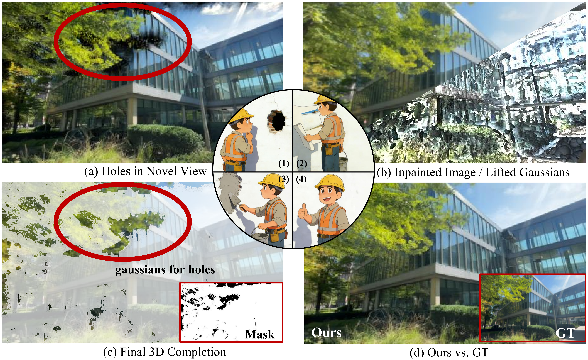

<h1 align="center">GSCompleter: A Distillation-Free Plugin for Metric-Aware 3D Gaussian Splatting Completion in Seconds</h1>

<p align="center">
  <a href="https://yuhuoo.github.io/">Ao Gao</a> &middot;
  <a href="https://jingyugong.github.io/">Jingyu Gong</a> &middot;
  <a href="https://tanxincs.github.io/">Xin Tan</a> &middot;
  <a href="https://faculty.ecnu.edu.cn/_s16/zzz2/main.psp">Zhizhong Zhang</a> &middot;
  <a href="https://dmcv.sjtu.edu.cn/people/">Lizhuang Ma</a> &middot;
  <a href="https://scholar.google.com/citations?user=RN1QMPgAAAAJ&amp;hl=zh-CN&amp;oi=ao">Yuan Xie</a>
</p>

<h3 align="center">
  <a href="https://arxiv.org/pdf/2604.20155">Paper (arXiv)</a>
  &nbsp;|&nbsp;
  <a href="https://yuhuoo.github.io/projects/gscompleter/">Project Page</a>
</h3>

<p align="center">
  
</p>

GSCompleter extends a scene reconstructed from sparse posed observations into target views with missing coverage. It uses PE-Field to generate a target-view image, lifts that image into candidate Gaussians with a reconstruction backbone, and integrates the candidates through depth alignment, ray-constrained registration, and multi-view refinement.


## Contents

- [Repository layout](#repository-layout)
- [Clone and version management](#clone-and-version-management)
- [Setup](#setup)
- [Data preparation](#data-preparation)
- [DepthSplat completion](#depthsplat-completion)
- [ADGaussian / Waymo completion](#adgaussian--waymo-completion)
- [Experiments and outputs](#experiments-and-outputs)
- [Reproduction notes](#reproduction-notes)
- [Acknowledgements and licenses](#acknowledgements-and-licenses)

## Repository layout

```text
GSCompleter/
├── README.md
├── .gitmodules
├── assets/
│   └── teaser.png                    # Project teaser
├── PE-Field/                         # View generation, local diffusers and MoGe
│   ├── pipeline_pe_field.py         # Pose-conditioned integration used by DepthSplat
│   ├── infer_viewchanger_single_v2.py
│   └── requirements.txt
└── src/
    ├── DepthSplat/
    │   ├── src/infer.py             # Completion/evaluation entry point
    │   ├── src/infer_longseq.py      # Additional sequence inference implementation
    │   ├── src/model/encoder/encoder_refinedsplat.py
    │   ├── config/                  # Hydra experiment and completion settings
    │   ├── assets/                  # Included evaluation indices
    │   ├── tools/                   # Metrics, statistics, and export tools
    │   └── eval_*.sh                # Dataset evaluations and ablations
    └── ADGaussian/
        ├── src/dataset/waymo_gscompleter_dataset.py
        ├── experiments/waymo_completion/
        │   ├── manifest.py         # Deterministic context/next-frame pairs
        │   ├── pe_generate.py      # Generate and record PE-Field hypotheses
        │   ├── pe_image.py         # Waymo-specific PE-Field integration
        │   ├── evaluate_waymo.py   # Five-stage completion comparison
        │   ├── gscompleter_core.py # Alignment, registration, opacity refinement
        │   └── gscompleter_utils.py
        └── scripts/                # Fixed-protocol generation/evaluation wrappers
```

| Submodule | Repository | Configured branch |
| --- | --- | --- |
| `src/DepthSplat` | [GSCompleter-DepthSplat](https://github.com/Yuhuoo/GSCompleter-DepthSplat) | `gs_completer_v1` |
| `src/ADGaussian` | [GSCompleter-ADGaussian](https://github.com/Yuhuoo/GSCompleter-ADGaussian) | `gscompleter` |
| `PE-Field` | [GSCompleter-PE-Field](https://github.com/Yuhuoo/GSCompleter-PE-Field) | `gscompleter` |

The parent repository records exact submodule commits. The branch names configure explicit remote updates; they do not make a normal clone follow future commits automatically.

## Clone and version management

```bash
git clone --recurse-submodules https://github.com/Yuhuoo/GSCompleter.git
cd GSCompleter
export GSCOMPLETER_ROOT="$PWD"
git submodule status
```

For an existing checkout, restore the versions recorded by the parent repository:

```bash
git submodule update --init --recursive
```

A detached HEAD inside a freshly initialized submodule is normal. To deliberately update to the configured remote branches:

```bash
git submodule update --remote src/DepthSplat src/ADGaussian PE-Field
git diff --submodule
# Review the changes, then commit the updated submodule pointers in the parent.
```

## Setup

The commands below use **Linux/Bash**. Use an NVIDIA GPU, a CUDA-compatible PyTorch installation, and the CUDA compiler/build tools required by the Gaussian rasterizers. Native Windows execution has not been established by this documentation. Video export additionally requires FFmpeg.

There is no unified, locked environment for all three submodules. Use separate environments for the backbone pipelines when their dependencies differ, and install PE-Field dependencies in each environment that runs generation.

### DepthSplat environment

The upstream DepthSplat README specifies Python 3.10 and PyTorch 2.4.0 with CUDA 12.4 as its installation baseline:

```bash
conda create -n gscompleter-depthsplat python=3.10 -y
conda activate gscompleter-depthsplat
cd "$GSCOMPLETER_ROOT/src/DepthSplat"
python -m pip install torch==2.4.0 torchvision==0.19.0 \
  --index-url https://download.pytorch.org/whl/cu124
python -m pip install -r requirements.txt
python -m pip install scipy scikit-learn torchmetrics torch-fidelity
python -m pip install -r "$GSCOMPLETER_ROOT/PE-Field/requirements.txt"
python -m pip install \
  "git+https://github.com/EasternJournalist/utils3d.git@c5daf6f6c244d251f252102d09e9b7bcef791a38"
export PYTHONPATH="$GSCOMPLETER_ROOT/PE-Field${PYTHONPATH:+:$PYTHONPATH}"
```

These are dependency installation starting points, not a verified combined environment lock. PE-Field's requirements are largely unpinned; preserve a compatible PyTorch/CUDA/xFormers combination when resolving them. MoGe imports `utils3d`, although its installation line is commented out in PE-Field's requirements.

**DepthSplat rasterizer compatibility is required.** Its completion decoder unpacks five values from `GaussianRasterizer`: `image, feature_map, alpha_mask, depth_map, radii`. The requirements file references `dcharatan/diff-gaussian-rasterization-modified`; verify that the installed build exposes this exact interface. A build returning only RGB and radii cannot run the completion path. This checkout does not vendor the compatible five-output rasterizer source.

The DepthSplat refiner also prepends a hard-coded external PE-Field directory to `sys.path`. If that directory does not exist, the `PYTHONPATH` above allows it to find this checkout. If an old copy exists at that location, update `external_pe_root` in `src/DepthSplat/src/model/encoder/encoder_refinedsplat.py` so the intended code is loaded.

### ADGaussian environment

Follow the [ADGaussian preparation instructions](src/ADGaussian/README.md#preparation) and its MVSplat/MASt3R dependency stack. The submodule has no top-level requirements file or complete environment lock. Install the bundled rasterizer in the selected CUDA/PyTorch environment:

```bash
cd "$GSCOMPLETER_ROOT/src/ADGaussian"
python -m pip install ./scripts/submodules/diff-gaussian-rasterization_ms
```

Install PE-Field's dependencies and `utils3d` in the environment used for `pe_generate.py`, as described above. The two backbones import different rasterizer packages: `diff_gaussian_rasterization` for DepthSplat and `diff_gaussian_rasterization_ms` for ADGaussian.

### Model weights

Download model weights separately. Cloning the repositories does not download the inference models.

| Component | Source | Expected location |
| --- | --- | --- |
| DepthSplat reconstruction | [Model zoo](src/DepthSplat/MODEL_ZOO.md), [Hugging Face](https://huggingface.co/haofeixu/depthsplat) | `src/DepthSplat/pretrained/` |
| ADGaussian Waymo | [Pretrained weights linked by ADGaussian](https://drive.google.com/drive/folders/1vlPobBvzWmfVmdkNMrioH9rNF475QxpM?usp=sharing) | Pass the checkpoint through `--checkpoint` or `CHECKPOINT` |
| FLUX.1-Kontext base components | [FLUX.1-Kontext-dev](https://huggingface.co/black-forest-labs/FLUX.1-Kontext-dev) | `PE-Field/FLUX.1-Kontext-dev/` |
| PE-Field transformer | [PE-Field transformer](https://huggingface.co/yunpeng1998/PE-Field/tree/main/FLUX.1-Kontext-dev/transformer) | `PE-Field/checkpoints/transformer/` |
| MoGe 2 | [moge-2-vitl-normal](https://huggingface.co/Ruicheng/moge-2-vitl-normal) | `PE-Field/moge-2-vitl-normal/model.pt` |

Use the PE-Field transformer with the FLUX base components. Its directory must include the actual weight shards in addition to the configuration and shard index already present in the repository. Model access and use follow the respective providers' terms. DepthSplat also initializes DINOv2 through `torch.hub`; prepare its cache for offline runs.

## Data preparation

### DepthSplat: DL3DV, RealEstate10K, and ACID

Follow [DATASETS.md](src/DepthSplat/DATASETS.md) to prepare PyTorch chunk files and the scene-to-chunk index:

```text
src/DepthSplat/datasets/
├── dl3dv/test/{000000.torch, ..., index.json}
├── re10k/test/{000000.torch, ..., index.json}
└── acid/test/{000000.torch, ..., index.json}
```

Use symbolic links or override `dataset.roots` to point to external storage. `dataset.roots` refers to the dataset directory containing `test/`, not to an individual chunk. Set `dataset.ori_image_shape` to the stored image dimensions when required by the dataset adapter.

Evaluation uses a separate JSON file mapping scene IDs to context and target frame indices. Several scripts reference `assets/evaluation_index_extrapolation/` and `assets/long_seq/`, which are **absent from this checkout**. Obtain the original splits for exact experiment reproduction, or generate a new split and record its sampling settings:

```bash
cd "$GSCOMPLETER_ROOT/src/DepthSplat"
python -m src.scripts.generate_extrapolation_index \
  --data_dir datasets/dl3dv/test \
  --type dl3dv --mode default \
  --num_context_views 2 --num_target_views 1 \
  --view_selection_num 100 --output_dir assets
```

This command writes `assets/evaluation_index_extrapolation/dl3dv/dl3dv_default_ctx2_tgt1.json`. It uses farthest-point target selection within the search range; it does not recreate a missing `*_n10.json` or `*_n30.json` protocol simply by changing the filename.

Camera intrinsics are normalized by image width/height. Extrinsics use OpenCV camera-to-world coordinates: +X right, +Y down, +Z forward.

### ADGaussian: processed Waymo validation data

The completion adapter expects the following per-scene layout, with three-digit scene/frame names and camera ID `0` by default:

```text
validation/
└── 000/
    ├── images_4/          # 000_0.jpg, 001_0.jpg, ...
    ├── depth_flows_4/     # 000_0.npy, 001_0.npy, ...
    ├── intrinsics/        # 0.txt: fx, fy, cx, cy, ...
    ├── extrinsics/        # 0.txt: 4x4 camera-to-ego matrix
    ├── ego_pose/          # 000.txt, 001.txt, ...: 4x4 ego poses
    └── dynamic_masks/     # 001_0.png, ...: nonzero marks dynamic pixels
```

Depth is a metric depth array, or channel zero of a multi-channel depth/flow array. The adapter uses `320 × 480` input images and normalizes calibration against an original size of `1280 × 1920`. A different preprocessing convention requires matching changes to the dataset configuration and PE generation, which also uses a fixed `320 × 480` image size.

`manifest.py` selects one file-complete adjacent pair per scene: the lower median pair in temporal order, with context frame `t` and target `t+1`. The manifest records camera motion and makes sample selection independent of model results. Target depth and dynamic masks are required for evaluation and pair availability; they are not completion inputs.

## DepthSplat completion

After preparing the environment, compatible rasterizer, PE-Field assets, and data, run from the **DepthSplat submodule root**. The example below uses the newly generated split, two context views, one target view, and an explicit network image size:

```bash
cd "$GSCOMPLETER_ROOT/src/DepthSplat"
export PYTHONPATH="$GSCOMPLETER_ROOT/PE-Field${PYTHONPATH:+:$PYTHONPATH}"
CUDA_VISIBLE_DEVICES=0 python -m src.infer +experiment=dl3dv \
  mode=test \
  'dataset.roots=[datasets/dl3dv]' \
  'dataset.image_shape=[256,448]' \
  dataset/view_sampler=evaluation \
  dataset.view_sampler.num_context_views=2 \
  dataset.view_sampler.index_path=assets/evaluation_index_extrapolation/dl3dv/dl3dv_default_ctx2_tgt1.json \
  model.encoder.num_scales=2 \
  model.encoder.upsample_factor=4 \
  model.encoder.lowest_feature_resolution=8 \
  model.encoder.monodepth_vit_type=vitb \
  checkpointing.pretrained_model=pretrained/depthsplat-gs-base-dl3dv-256x448-randview2-6-02c7b19d.pth \
  test.using_refinement=true \
  test.using_gscompleter=true \
  test.using_stereo_anchor=true \
  test.using_depth_alignment=true \
  test.using_rc_register=true \
  test.using_mv_refinement=true \
  test.using_target_align=false \
  test.save_image=true \
  test.save_gt_image=true \
  test.save_scene_metrics=true \
  output_dir=outputs/dl3dv_completion
```

For RealEstate10K and ACID, consult [eval_re10k.sh](src/DepthSplat/eval_re10k.sh) and [eval_acid.sh](src/DepthSplat/eval_acid.sh) for dataset/model settings. Review their active flags and split paths: the active RealEstate10K example currently runs the baseline, while the completion variant is commented out.

### Completion and ablation switches

All flags below belong to `test.*` in [config/main.yaml](src/DepthSplat/config/main.yaml).

| Setting | Purpose |
| --- | --- |
| `using_refinement` | Enables generated-view lifting and scene expansion |
| `using_gscompleter` | Enables the completion optimizer for generated Gaussians |
| `using_stereo_anchor` | Uses stereo-aware geometry-anchor selection instead of nearest-camera selection |
| `using_depth_alignment` | Uses the anchor-derived depth scale/shift |
| `using_rc_register` | Enables ray-constrained registration when `registration_mode=legacy` |
| `using_mv_refinement` | Enables opacity refinement using context and generated target appearance |
| `using_target_align` | Aligns against depth rendered from the context scene at the target camera; the full example uses anchor alignment instead |
| `hole_mask_threshold`, `dilation_radius` | Coverage threshold and hole-mask expansion; defaults: `0.5`, `3` |
| `registration_mode` | `legacy`, `ray`, or `free` for constrained/unconstrained registration comparisons |

Use these combinations for the main comparison, keeping data, weights, and other settings fixed:

| Variant | `using_refinement` | `using_gscompleter` | Other completion flags |
| --- | --- | --- | --- |
| Backbone baseline | `false` | `false` | Disabled |
| Generated content only | `true` | `false` | Stereo anchor enabled; alignment/registration/refinement disabled |
| Full GSCompleter | `true` | `true` | Stereo anchor, depth alignment, ray registration, and multi-view refinement enabled |

`src.infer` currently constructs PE-Field even for the baseline, so that entry point still requires its dependencies and weights. The generated-only variant merges hole-filtered candidates into the scene; it is a 3D scene variant, not just the generated 2D image.

## ADGaussian / Waymo completion

The Python entry points support a manifest-based workflow. Before using your own processed validation split, set `data_path` in [waymo_gscompleter.yaml](src/ADGaussian/config/dataset/waymo_gscompleter.yaml) to its absolute path. Use the same path for `DATA_ROOT` below. In the current evaluator, `--data-root` controls evaluation-label loading but does not override the context adapter's `cfg.dataset.data_path`; both must agree. Keep `camera_id: 0` for this example.

After preparing the ADGaussian environment and all model assets:

```bash
cd "$GSCOMPLETER_ROOT/src/ADGaussian"
export DATA_ROOT="/path/to/processed/waymo/validation"
export CHECKPOINT="/path/to/waymo_best.ckpt"
export PE_FIELD_ROOT="$GSCOMPLETER_ROOT/PE-Field"
export RUN_DIR="$PWD/outputs/waymo_custom"

python experiments/waymo_completion/manifest.py \
  --data-root "$DATA_ROOT" --camera-id 0 \
  --output "$RUN_DIR/manifest.json"

CUDA_VISIBLE_DEVICES=0 python experiments/waymo_completion/pe_generate.py \
  --manifest "$RUN_DIR/manifest.json" \
  --data-root "$DATA_ROOT" --pe-field-root "$PE_FIELD_ROOT" \
  --output-dir "$RUN_DIR/pe" --steps 4 --seed 20260907 \
  --hash-model-weights

python experiments/waymo_completion/pe_check.py \
  --manifest "$RUN_DIR/manifest.json" --pe-dir "$RUN_DIR/pe" \
  --data-root "$DATA_ROOT" --pe-field-root "$PE_FIELD_ROOT" \
  --generator experiments/waymo_completion/pe_generate.py \
  --pipeline experiments/waymo_completion/pe_image.py

CUDA_VISIBLE_DEVICES=0 python experiments/waymo_completion/evaluate_waymo.py \
  --manifest "$RUN_DIR/manifest.json" --pe-dir "$RUN_DIR/pe" \
  --data-root "$DATA_ROOT" --checkpoint "$CHECKPOINT" \
  --output-dir "$RUN_DIR/completion"
```

Generation and completion may run in separate environments through the cached PE images. The evaluator saves five stages: `baseline`, `direct`, `aligned`, `ray_registered`, and `full`. Its frozen settings include an alpha threshold of `0.5`, a dilation radius of `3`, `50` ray-registration steps, and `30` opacity-refinement steps. Changing those CLI values is rejected by the current evaluator.

The shell wrappers [run_pe_generation.sh](src/ADGaussian/scripts/run_pe_generation.sh) and [run_waymo_completion.sh](src/ADGaussian/scripts/run_waymo_completion.sh) implement a stricter, fixed experiment protocol. They check a particular manifest SHA-256; the completion wrapper additionally requires exactly **202** PE images, a local `runtime/python` directory, and an experiment README that is absent here. Use the direct Python entry points for a custom manifest. Restoring the original assets is necessary to reproduce the wrapper protocol unchanged; the custom workflow is not that fixed benchmark.

For standalone angle-controlled PE-Field inference, see the [PE-Field README](PE-Field/README.md#inference). This is a view-generation demo; it does not perform Gaussian scene completion.

## Experiments and outputs

### DepthSplat

| Experiment | Entry points in `src/DepthSplat/` |
| --- | --- |
| Dataset evaluations | `eval_dl3dv.sh`, `eval_re10k.sh`, `eval_acid.sh` |
| Ablations and generated-only comparison | `eval_ablation_study.sh`, `eval_more_ablation_study.sh`, `eval_three_way_re10k_acid.sh` |
| Sequential completion | `eval_long_seq_dl3dv.sh`, `eval_long_seq_re10k.sh` |
| Sensitivity and robustness | `eval_sensitivity_dl3dv.sh`, `eval_registration_robustness_dl3dv.sh`, `eval_anchor_motion_dl3dv.sh` |
| Runtime profiling | `eval_runtime_dl3dv.sh`, `tools/summarize_runtime.py` |
| Completion/observation region metrics | `eval_region_metrics_dl3dv.sh`, `tools/evaluate_region_metrics.py` |
| Paired scene analysis | `tools/analyze_paired_scene_metrics.py` |
| External comparison export | `prepare_dl3dv_pairs.sh`, `collect_dl3dv_outputs.sh` |

Inspect GPU assignments, absolute paths, split availability, output directories, and enabled flags before using the shell scripts. Some scripts launch multiple GPU jobs.

The example inference produces:

```text
outputs/dl3dv_completion/
├── images/<scene>/color/         # Target renders and optional *_gt.png images
├── debug/vis/<scene>/           # Generated views, coverage masks, alignment diagnostics
├── metrics/benchmark.json
├── metrics_summary.txt          # Image-quality summary, including PSNR/SSIM/LPIPS
├── runtime_summary.json         # Stage-level timings
└── per_scene_metrics.csv        # With test.save_scene_metrics=true
```

Optional flags include `test.save_gaussian=true`, `test.save_depth=true`, `test.save_colmap=true`, and `test.save_virtual_video=true`. Coverage diagnostics saved as `*_tgt_align_mask.png` mark **valid coverage**; the region-metric tool inverts this mask to identify the completion region. Use a fixed mask from before generated-content insertion for fair region comparisons.

### Waymo

The direct completion evaluator writes `metrics.jsonl`, `provenance.json`, and `qualitative/completed/*.png` under its output directory. Geometry is evaluated over static full-image and hole regions, including depth error, 3D point error, Chamfer distance, and coverage/F-score measures. These outputs are distinct from DepthSplat's RGB image-quality metrics.

PE generation separately records `generation_records.jsonl`, `generation_provenance.json`, and per-sample debug images. The audit checks input/output hashes and whether the recorded inputs match the manifest. The fixed shell workflow adds result assembly, bootstrap summaries, selected comparison sheets, environment records, and checksums.

DepthSplat's stage-level timing includes PE generation. Waymo's `runtime_full_seconds` starts after its cached PE image is loaded, so it excludes PE generation. Do not compare these values as equivalent end-to-end runtimes.

## Reproduction notes

- **Run from the correct submodule root.** Both backbone projects define a Python package named `src`. Running their commands from the parent directory can resolve the wrong modules or configuration paths.
- **Load the local PE-Field code.** The bundled `diffusers/` contains PE-Field-specific behavior. Confirm that imports resolve to this checkout rather than an unrelated installed copy.
- **Prepare all external assets.** Model shards, datasets, and the extrapolation/long-sequence splits referenced by several scripts are absent. A configuration or shard-index file alone is not a model checkpoint.
- **Check the rasterizer API.** DepthSplat needs its five-output renderer interface. ADGaussian uses its separate `_ms` extension; the fixed Waymo wrapper additionally expects a local runtime directory.
- **Preserve the experiment definition.** Match data preprocessing, camera conventions, split, image dimensions, checkpoint architecture, completion flags, and metric region. A newly generated split is a new evaluation setting.
- **Treat geometry diagnostics according to their reference.** DepthSplat's internal TTO geometry diagnostics compare against the context reconstruction, not independently measured target geometry. Waymo's evaluator uses held-out target depth after completion.

The examples above document the checked-in code and its required inputs. A complete GPU inference run has not been validated as part of this README rewrite.

## Acknowledgements and licenses

GSCompleter builds on [DepthSplat](https://github.com/cvg/depthsplat), [ADGaussian](https://maggiesong7.github.io/research/ADGaussian/), PE-Field, [MoGe](https://github.com/microsoft/MoGe), FLUX.1-Kontext, and their dependencies. See the submodule READMEs for upstream citations and attribution.

Licenses apply per component. The parent repository currently has no top-level license declaration; do not assume that DepthSplat's MIT license covers the other submodules, bundled rasterizers, pretrained models, or datasets. Consult their respective license files and model/data terms.
